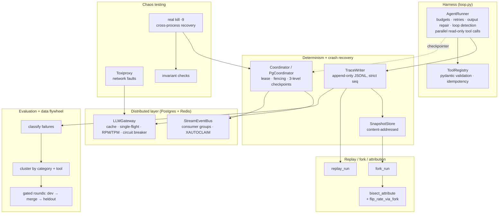

# RewindHarness

[](https://github.com/YOUR_USERNAME/RewindHarness/actions/workflows/ci.yml)


**A replayable, forkable, crash-safe runtime for LLM agents — with counterfactual root-cause attribution and an evaluation loop that tests whether a fix actually worked.**

Most agent frameworks make it easy to *run* an agent and hard to answer the questions that come after a failure: *What exactly happened? Which step caused it? If I change that step, does the run succeed? And did my fix really help, or was that noise?* RewindHarness is built around those questions.

- **Deterministic replay** — every LLM call is recorded and request-hashed, so a run can be replayed byte-for-byte and any drift in prompt construction is caught immediately.
- **Counterfactual forks** — restore the environment snapshot at step *k*, swap in a different action, and continue live.
- **Crash recovery** — three-level checkpoints (intent → per-tool → step) with leases and fencing tokens; a crash at *any* point resumes without re-running side-effecting tools.
- **Root-cause attribution** — bisect over forked re-runs to find the earliest step whose correction flips the outcome.
- **Distributed execution** — Postgres job queue (`FOR UPDATE SKIP LOCKED`) and a Redis LLM gateway (cache, single-flight, RPM/TPM rate limiting, shared circuit breaker).
- **Real chaos testing** — real `kill -9` of worker processes and real network faults injected with Toxiproxy.
- **Evaluation on a real benchmark** — DeepSeek on the τ-bench retail domain, failure classification, a targeted patch, and multi-trial bootstrap analysis.

> The Python package is named `rewind`, so the CLI and imports use that name.

## Headline results

| Experiment | Result |
|---|---|
| **Real-model baseline** — `deepseek-chat` on τ-bench retail, test split (115 tasks) | pass^1 = **70.4%** (81/115) |
| **Failure attribution** on the 34 real failures | 52.9% wrong action, 32.4% tool runtime error; 12 of the 22 wrong-action failures had the right tool sequence but wrong arguments; found one reproducible ordering bug (3 tasks) |
| **Did the fix work?** Patched vs. unpatched, 3 trials each (345 samples), paired bootstrap | pooled pass^1 72.2% → 75.4%, 95% CI **[−2.0%, +8.7%]** includes 0. A no-change re-run alone moved pass^1 by +9 points, so a single-trial "+2" proves nothing. **Conclusion: no statistically significant effect** |
| **Crash recovery** — crash injected at each of 7 checkpoint hooks | correct final state every time; side-effecting `cancel_order` executed **exactly once**; trace sequence numbers stay contiguous |
| **Recovery time** — real `kill -9`, 20 trials, 2 s lease | p50 0.316 s, p99 0.376 s |
| **Scaling** — 40 jobs on real Postgres, 1/2/4/8 workers | 64 → 91 → 116 → 102 jobs/s (peaks at 4 workers on 2 vCPUs) |
| **Single-flight** — 6 identical concurrent LLM requests through Redis | upstream provider called **once** |
| **Parallel tool calls** — 5 read-only calls in one turn, 0.2 s each | 1.00 s serial → **0.209 s**; mutating calls stay strictly ordered |
| **Postgres claim query** — 50k historical rows | 8.2 ms seq scan → 0.046 ms with a partial index (~180×), asserted from `EXPLAIN` |
| **Attribution accuracy** — synthetic ground truth, 5 root-cause positions | 100% exact match, 2.4 oracle calls on average |

The τ-bench evaluation is the part I would point to first: the obvious single-run story ("my patch improved pass^1 by 2 points") turned out not to hold up once the noise floor was measured. The full write-up is in the [dev log](docs/DEVLOG.zh-CN.md).

## Architecture



## Quickstart

Everything below runs offline, with no API key and no external services.

```bash
git clone https://github.com/YOUR_USERNAME/RewindHarness.git
cd RewindHarness
python -m venv .venv && source .venv/bin/activate
pip install -e ".[dev]"

pytest -q                                     # infra-dependent tests skip themselves

rewind demo --out runs                        # run fails → replay it → fork at step 2 with a fix
rewind ckpt-demo --out runs/ckpt-demo         # worker crashes mid-run → second worker resumes
rewind attribute-demo --out runs/attr-demo    # bisect to the root-cause step
rewind attribute-eval                         # attribution accuracy on synthetic ground truth
```

Example output of `rewind demo` and `rewind ckpt-demo`:

```text
[run]    status=completed steps=3 graded_ok=False
[replay] ok=True events=19
[fork]   status=completed graded_ok=True (parent=demo-base, fork_step=2)

[crash]  worker A killed right after cancel_order applied (latest durable checkpoint: step=2 kind=tool)
[resume] status=completed graded_ok=True O1_status=cancelled
```

### Running with a real model

```bash
pip install -e ".[deepseek]"            # or ".[anthropic]"
cp .env.example .env                    # add your key; .env is git-ignored
set -a; source .env; set +a

rewind run --task "I'm u1, cancel my headphones order" --provider deepseek
rewind replay runs/<run-id>/trace.jsonl --snapshots runs/snapshots
rewind fork runs/<run-id>/trace.jsonl --at 2 \
  --patch '{"tool_calls":[{"name":"get_order","args":{"order_id":"O1"}}]}'
```

The τ-bench experiments are driven by `scripts/run_taubench_*.sh` (baseline, round-1 patch, noise floor, multi-trial) and analysed with `scripts/taubench_multitrial_compare.py`. τ-bench is not on PyPI; install it with `pip install -e ".[taubench]"`.

### Running the infrastructure tests

The distributed and chaos tests need a local Postgres, Redis, and the `toxiproxy-server` binary. Without them those tests are skipped, not failed.

```bash
pip install -e ".[dev,dist,chaos]"

# Postgres + Redis (macOS: brew install postgresql@16 redis && brew services start ...)
createuser -s rewind && psql -c "ALTER ROLE rewind PASSWORD 'rewind';" postgres
createdb -O rewind rewind_test

# Toxiproxy: a single static binary, no Docker needed.
# Pick your platform's asset (darwin-arm64, linux-amd64, ...) and put it on your PATH.
mkdir -p ~/.local/bin
curl -sSL -o ~/.local/bin/toxiproxy-server \
  https://github.com/Shopify/toxiproxy/releases/download/v2.9.0/toxiproxy-server-darwin-arm64
chmod +x ~/.local/bin/toxiproxy-server
export PATH="$HOME/.local/bin:$PATH"

bash scripts/ci_nightly.sh             # full suite: 131 pass, 5 skip without τ-bench installed
```

Connection strings can be overridden with `REWIND_PG_DSN` and `REWIND_REDIS_URL`.

## Key design decisions

- **Replay by recording, not by `temperature=0`.** Every provider attempt, including failures, is logged with a hash of the request. During replay a mismatch in the hash fails immediately, which catches any change in how the harness builds prompts.
- **The idempotency ledger is checkpointed together with the state it protects.** The first version checkpointed only at the end of each step. Tests showed that a crash between "tool executed" and "step checkpointed" re-ran `cancel_order`. The fix was a per-tool checkpoint that includes the ledger, so on resume completed actions return their cached result.
- **Fencing tokens, not just leases.** A stale worker that wakes up after its lease expired is rejected on its next write and aborts cleanly, so it cannot overwrite the new owner's progress.
- **Locks prove ownership before release and renewal.** Gateway locks use compare-and-delete and compare-and-extend Lua scripts. A heartbeat renews the single-flight lock during slow LLM calls. Without it, a call that outlived the lock TTL was silently duplicated. Removing the heartbeat makes the regression test fail with exactly that duplicate call.
- **Parallelism only where it is provably safe.** Tool calls in the same turn were generated without seeing each other's results, so read-only calls in that turn run concurrently. Mutating calls keep their original order, because a later mutation can depend on the effect of an earlier one.
- **Measure the noise floor before claiming an improvement.** All τ-bench comparisons use the same protocol, report flips in both directions, and use multi-trial paired bootstrap confidence intervals.

## Project layout

```text
src/rewind/
  loop.py, tools.py, providers.py     agent loop, tool registry, LLM providers (Anthropic, DeepSeek, scripted)
  trace.py, events.py, snapshot.py    append-only trace, event schema, content-addressed snapshots
  replay.py, fork.py                  deterministic replay and counterfactual forks
  checkpoint.py, worker.py            sqlite coordinator, checkpointer, job execution
  dist/                               Postgres coordinator, Redis gateway and event stream, Toxiproxy, invariants
  flywheel/                           failure classification, attribution, data flywheel, τ-bench failure analysis
  env/                                offline toy retail env and the τ-bench retail adapter
scripts/                              experiments, τ-bench runs and comparisons, CI entry points
tests/                                136 tests (pytest + hypothesis)
docs/DEVLOG.zh-CN.md                  detailed design notes and experiment log (Chinese)
```

## Development milestones

Module docstrings refer to the milestones the project was built in:

| Milestone | Scope |
|---|---|
| W1 | Agent loop and tool registry; later, the τ-bench adapter and real DeepSeek evaluation |
| W2–W3 | Trace, deterministic replay, counterfactual fork |
| W4 | Checkpoints and crash recovery |
| W5 | Distributed layer on Postgres and Redis |
| W6 | Chaos testing with real `kill -9` and Toxiproxy |
| W7 | Failure classification and root-cause attribution |
| W8 | Data flywheel and CI regression gate |

## Limitations

I have tried to be explicit about what is and isn't demonstrated:

- The W7 attribution accuracy (100%) uses **synthetic** ground truth. Real failures are non-monotonic and noisy, so real accuracy will be lower.
- The W8 data flywheel runs on a **deterministic heuristic policy**, not a real LLM. It validates the mechanics (split → classify → cluster → gate → merge), and its candidate fixes come from a fixed lookup table.
- Replay, fork, and checkpoint CLI commands work on the toy environment. The τ-bench adapter supports snapshot and restore but isn't wired into those commands yet.
- Chaos tests run two processes on a single machine. Multi-host network partitions are not covered.
- The circuit breaker's half-open state is simplified to a TTL rather than a single probe request.
- Known open issues in the distributed layer are listed in the dev log's "next steps" section. They include model identity missing from the gateway cache key, in-memory stream dedup state, and no dead-letter handling for poison messages or jobs.

## License

[MIT](LICENSE)
