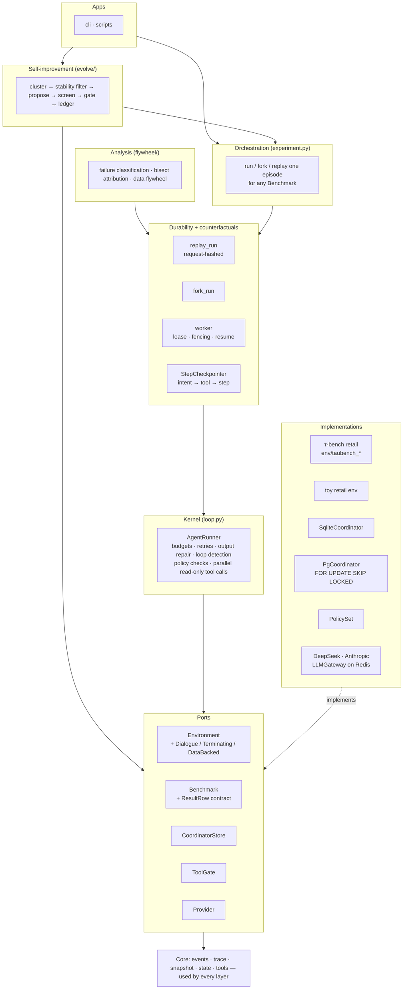

# RewindHarness

[](https://github.com/Danica-Yan/RewindHarness/actions/workflows/ci.yml)


**A replayable, forkable, crash-safe runtime for LLM agents — with counterfactual root-cause attribution, an evaluation loop that tests whether a fix actually worked, and a gated self-improvement loop in which an LLM proposes context edits and statistics decide whether they ship.**

Most agent frameworks make it easy to *run* an agent and hard to answer the questions that come after a failure: *What exactly happened? Which step caused it? If I change that step, does the run succeed? And did my fix really help, or was that noise?* RewindHarness is built around those questions.

- **Deterministic replay** — every LLM call is recorded and request-hashed, so a run can be replayed byte-for-byte and any drift in prompt construction is caught immediately.
- **Counterfactual forks** — restore the environment snapshot at step *k*, swap in a different action, and continue live.
- **Crash recovery** — three-level checkpoints (intent → per-tool → step) with leases and fencing tokens; a crash at *any* point resumes without re-running side-effecting tools.
- **Root-cause attribution** — bisect over forked re-runs to find the earliest step whose correction flips the outcome.
- **Distributed execution** — Postgres job queue (`FOR UPDATE SKIP LOCKED`) and a Redis LLM gateway (cache, single-flight, RPM/TPM rate limiting, shared circuit breaker).
- **Real chaos testing** — real `kill -9` of worker processes and real network faults injected with Toxiproxy.
- **Evaluation on a real benchmark** — DeepSeek on the τ-bench retail domain, failure classification, a targeted patch, and multi-trial bootstrap analysis.
- **Real multi-turn episodes inside the runtime** — τ-bench's LLM user simulator is part of the env snapshot, so real conversations can be replayed and forked like any other run.
- **Gated self-improvement (Evolve)** — failures are clustered, filtered for reproducibility with null forks, an LLM proposes context edits, and an edit ships only after proving an effect on held-out failures *and* no harm on tasks it never saw. Model weights never change.
- **Policy checks (rules → code)** — mechanical policies (explicit yes before a write, act only for the authenticated user, look an order up before changing it) run as declarative checks before a tool executes; a blocked call never runs and the agent gets the reason back. Checks are backtested on recorded traces with zero API calls before Evolve spends any episode on them.
- **Skill library** — procedures induced from *successful* episodes (one LLM call per task type), shown to the agent as a one-line index and loaded on demand with `load_skill`, so the trace records when a skill was used. The whole library is gated as one version against the incumbent's freshly measured rate on held-out failures.
- **Compounding without regressing** — regression memory (every task an accepted version fixed is re-checked by every later gate), consolidation by ablation (a learned item is removed when dropping it costs nothing on the fixes it is remembered for), and a meta level: the proposer's *lessons* are rewritten from the ledger history and adopted only if they produce more screened-in candidates than the old lessons on the same clusters. The gate itself is never editable by the loop.

> The Python package is named `rewind`, so the CLI and imports use that name.

## Headline results

| Experiment | Result |
|---|---|
| **Real-model baseline** — `deepseek-chat` on τ-bench retail, test split (115 tasks) | pass^1 = **70.4%** (81/115) |
| **Failure attribution** on the 34 real failures | 52.9% wrong action, 32.4% tool runtime error; 12 of the 22 wrong-action failures had the right tool sequence but wrong arguments; found one reproducible ordering bug (3 tasks) |
| **Did the fix work?** Patched vs. unpatched, 3 trials each (345 samples), paired bootstrap | pooled pass^1 72.2% → 75.4%, 95% CI **[−2.0%, +8.7%]** includes 0. A no-change re-run alone moved pass^1 by +9 points, so a single-trial "+2" proves nothing. **Conclusion: no statistically significant effect** |
| **Crash recovery** — crash injected at each of 7 checkpoint hooks | correct final state every time; side-effecting `cancel_order` executed **exactly once**; trace sequence numbers stay contiguous |
| **Recovery time** — real `kill -9`, 20 trials, 2 s lease | p50 0.316 s, p99 0.376 s |
| **Scaling** — 40 jobs on real Postgres, 1/2/4/8 workers | 64 → 91 → 116 → 102 jobs/s (peaks at 4 workers on 2 vCPUs) |
| **Single-flight** — 6 identical concurrent LLM requests through Redis | upstream provider called **once** |
| **Parallel tool calls** — 5 read-only calls in one turn, 0.2 s each | 1.00 s serial → **0.209 s**; mutating calls stay strictly ordered |
| **Postgres claim query** — 50k historical rows | 8.2 ms seq scan → 0.046 ms with a partial index (~180×), asserted from `EXPLAIN` |
| **Attribution accuracy** — synthetic ground truth, 5 root-cause positions | 100% exact match, 2.4 oracle calls on average |
| **Same benchmark inside rewind** — τ-bench test, 3 trials, rewind loop vs τ-bench's own `run.py` | pass^1 73.3% vs 72.2%, 95% CI [−3.5%, +5.8%]: indistinguishable (two `run.py` runs differ by [−8.4%, +5.5%]) |
| **Fork fidelity** — replay each fork with the parent's recorded model and user replies, hash-check every request | 391/391 fork points byte-identical on 40 τ-bench tasks (offline scripted episodes; the same check runs on real traces via `scripts/taubench_fork_fidelity.py`) — after fixing a bug where restored DB records came back with sorted keys and forked agents saw different tool output |
| **Null-fork calibration** — 20 parents × 4 fork points × 5 continuations | passing parents re-pass 86–96%; failing parents split into *stable* failures (≤1/5 pass) and *flaky* ones (mostly pass) — only stable ones are worth an edit |
| **Evolve, first real edit** — LLM-written rule on train (v0 pass^1 89.5%) | proven effect on 3 held-out stable failures (0/15 → 6/15, Fisher p = 0.008). First rejected by the original safety rule (188 unseen tasks, −3.7 pt, 12 broken vs 5 fixed); that rule turned out to be miscalibrated (next row). Re-gated with flip confirmation: **0 of 12 regressions and 0 of 5 fixes reproduce** on re-runs under both versions, so the pool flips were run-to-run noise. **Accepted as v1**, the first edit to pass the gate |
| **Gate audit** — simulated harmless edits, per-task flakiness fitted to the null-fork data | the "≤ 2 pt drop" rule rejected 18–24% of harmless edits. Replaced by flip confirmation (re-run flipped tasks under both versions): ~3% false rejections, ~99% power against 5 truly broken tasks |

The τ-bench evaluation and the Evolve gate are the parts I would point to first: the obvious single-run story ("my patch improved pass^1 by 2 points") turned out not to hold up once the noise floor was measured. The full write-up is in the [dev log](docs/DEVLOG.zh-CN.md).

## Architecture

Layered top to bottom; a layer depends only on layers below it. Ports are Protocols, and the boxes in *Implementations* plug into them, so the kernel, the durability layer and the self-improvement loop never name a concrete backend or benchmark.



**The layering is enforced, not just drawn.** `tests/test_layering.py` parses every module's imports (lazy imports included) and fails if `evolve/` imports a benchmark plugin, a plugin imports orchestration (`fork`, `replay`, `experiment`), the port imports anything that uses it, or the durability layer imports the agent runner. It also fails if a string constant in `evolve/` names one of τ-bench's tools or actions, which an import check cannot see. Both rules were checked by injecting the old coupling and watching the test fail.

Distributed execution (Postgres coordinator, Redis gateway and event stream) lives in `dist/` as implementations of the same ports; the chaos tests (real `kill -9`, Toxiproxy network faults, invariant checks) exercise them.

## Self-improvement loop (Evolve)

One round, run with `scripts/run_evolve.py` (`plan`, `round`, `gate-pending`, `status`, `rollback`):

1. **Run** the current context version on the benchmark's train tasks (τ-bench retail in every experiment so far; Evolve itself sees only the `Benchmark` port); every episode is a rewind trace.
2. **Cluster** failures by a deterministic signature (category | tool | which arguments differed), keep only clusters whose share of failed tasks has a Wilson lower bound above a floor.
3. **Stability filter**: re-run each failure from its first user turn with no change; only failures that pass ≤1 of 5 null forks are "stable". Flaky failures are never optimised.
4. **Split** stable failures into A (shown to the proposer) and B (held out); both leave the gate pool for good.
5. **Propose**: one DeepSeek call returns up to 3 candidate edits — a learned policy line or a tool-description note — seeing A's evidence and every previously rejected edit with its reason.
6. **Offline checks** reject case-specific text (order ids, emails, …), unknown tools, oversize context.
7. **Fork screen** on B against each task's own null-fork rate.
8. **Gate, efficacy**: fresh forks of B under the candidate vs their null passes, one-sided Fisher test.
9. **Gate, safety**: all never-shown tasks, paired with the incumbent: not significantly worse; then every task that flipped is re-run twice under both versions, and an edit is rejected if more than one breakage reproduces (incumbent passes every re-run, candidate fails every re-run).
10. **Commit** to a SQLite ledger (versions, every decision and its numbers) or reject with the reason. A rejection carries feedback — where the broken tasks concentrate and one before/after example — that the proposer sees on its next attempt at the same cluster (`retry`).

Every phase checks a worst-case episode budget before spending; `plan` prints the cost of a round without calling any API. `viewer/index.html` (no server, no network) shows every round's decisions and lets you open any task the gate saw flip, side by side under the old and new context, with the first differing tool call highlighted. The first real round is written up in the dev log: the gate stopped an edit that genuinely fixed its target failures but broke 12 tasks of the same kind.

## Quickstart

Everything below runs offline, with no API key and no external services.

```bash
git clone https://github.com/Danica-Yan/RewindHarness.git
cd RewindHarness
python -m venv .venv && source .venv/bin/activate
pip install -e ".[dev]"

pytest -q                                     # infra-dependent tests skip themselves

rewind demo --out runs                        # run fails → replay it → fork at step 2 with a fix
rewind ckpt-demo --out runs/ckpt-demo         # worker crashes mid-run → second worker resumes
rewind attribute-demo --out runs/attr-demo    # bisect to the root-cause step
rewind attribute-eval                         # attribution accuracy on synthetic ground truth
```

Example output of `rewind demo` and `rewind ckpt-demo`:

```text
[run]    status=completed steps=3 graded_ok=False
[replay] ok=True events=19
[fork]   status=completed graded_ok=True (parent=demo-base, fork_step=2)

[crash]  worker A killed right after cancel_order applied (latest durable checkpoint: step=2 kind=tool)
[resume] status=completed graded_ok=True O1_status=cancelled
```

### Running with a real model

```bash
pip install -e ".[deepseek]"            # or ".[anthropic]"
cp .env.example .env                    # add your key; .env is git-ignored
set -a; source .env; set +a

rewind run --task "I'm u1, cancel my headphones order" --provider deepseek
rewind replay runs/<run-id>/trace.jsonl --snapshots runs/snapshots
rewind fork runs/<run-id>/trace.jsonl --at 2 \
  --patch '{"tool_calls":[{"name":"get_order","args":{"order_id":"O1"}}]}'
```

The τ-bench experiments are driven by `scripts/run_taubench_*.sh` (baseline, round-1 patch, noise floor, multi-trial) and analysed with `scripts/taubench_multitrial_compare.py`. τ-bench is not on PyPI; install it with `pip install -e ".[taubench]"` (or point `REWIND_TAUBENCH_SRC` at a clone).

Real episodes inside rewind, and the self-improvement loop:

```bash
export DEEPSEEK_API_KEY=sk-... REWIND_TAUBENCH_SRC=../tau-bench
python scripts/run_taubench_rewind.py --split train --task-ids 0-199 \
    --out runs/p1/train_base.json --store-dir runs/p1/snapshots       # baseline (resumable)
python scripts/taubench_fork_fidelity.py runs/p1/train_base.json \
    --store-dir runs/p1/snapshots                                       # free: forks restore exactly
python scripts/run_evolve.py plan  --base runs/p1/train_base.json     # free: clusters + worst-case cost
python scripts/run_evolve.py round --base runs/p1/train_base.json --budget 260
python scripts/run_evolve.py status                                    # free: versions and decisions
python scripts/evolve_gate_report.py                                   # free: explain the last gate decision
python scripts/run_evolve.py retry                                     # re-propose for a cluster, with feedback
python scripts/run_evolve.py regate                                    # re-decide old rejections under the current gate
python scripts/run_evolve.py consolidate                               # does each learned item still earn its place?
python scripts/run_evolve.py reflect                                   # 1 LLM call: proposed proposer lessons
python scripts/run_evolve.py meta-eval                                 # adopt them only if they beat the old ones
python scripts/backtest_checks.py --results runs/p1/train_base.json --store-dir runs/p1/snapshots  # where policy checks would fire (no API)
python scripts/induce_skills.py plan --base runs/p1/train_base.json      # skill groups + cost of induce/gate (no API)
python scripts/export_viewer.py --run-dir runs/p1                      # free: then open viewer/index.html
```

### Running the infrastructure tests

The distributed and chaos tests need a local Postgres, Redis, and the `toxiproxy-server` binary. Without them those tests are skipped, not failed.

```bash
pip install -e ".[dev,dist,chaos]"

# Postgres + Redis (macOS: brew install postgresql@16 redis && brew services start ...)
createuser -s rewind && psql -c "ALTER ROLE rewind PASSWORD 'rewind';" postgres
createdb -O rewind rewind_test

# Toxiproxy: a single static binary, no Docker needed.
# Pick your platform's asset (darwin-arm64, linux-amd64, ...) and put it on your PATH.
mkdir -p ~/.local/bin
curl -sSL -o ~/.local/bin/toxiproxy-server \
  https://github.com/Shopify/toxiproxy/releases/download/v2.9.0/toxiproxy-server-darwin-arm64
chmod +x ~/.local/bin/toxiproxy-server
export PATH="$HOME/.local/bin:$PATH"

bash scripts/ci_nightly.sh             # full suite; τ-bench tests skip themselves if τ-bench is not installed
```

Connection strings can be overridden with `REWIND_PG_DSN` and `REWIND_REDIS_URL`.

## Key design decisions

- **Replay by recording, not by `temperature=0`.** Every provider attempt, including failures, is logged with a hash of the request. During replay a mismatch in the hash fails immediately, which catches any change in how the harness builds prompts.
- **The idempotency ledger is checkpointed together with the state it protects.** The first version checkpointed only at the end of each step. Tests showed that a crash between "tool executed" and "step checkpointed" re-ran `cancel_order`. The fix was a per-tool checkpoint that includes the ledger, so on resume completed actions return their cached result.
- **Fencing tokens, not just leases.** A stale worker that wakes up after its lease expired is rejected on its next write and aborts cleanly, so it cannot overwrite the new owner's progress.
- **Locks prove ownership before release and renewal.** Gateway locks use compare-and-delete and compare-and-extend Lua scripts. A heartbeat renews the single-flight lock during slow LLM calls. Without it, a call that outlived the lock TTL was silently duplicated. Removing the heartbeat makes the regression test fail with exactly that duplicate call.
- **Parallelism only where it is provably safe.** Tool calls in the same turn were generated without seeing each other's results, so read-only calls in that turn run concurrently. Mutating calls keep their original order, because a later mutation can depend on the effect of an earlier one.
- **Measure the noise floor before claiming an improvement.** All τ-bench comparisons use the same protocol, report flips in both directions, and use multi-trial paired bootstrap confidence intervals.
- **Check that a fork sees exactly what its parent saw, not just that it grades the same.** The key-order bug passed every outcome-level test (the grader hashes order-insensitively) and was only caught by null-fork calibration; the fidelity check now hash-verifies every model request of a forked continuation, for free.
- **Only optimise failures that reproduce.** Half the failed parents in calibration passed most null forks. Writing rules for those would "fix" randomness and fool the screen.
- **A targeted gate, not a whole-pool superiority test.** At a ~90% baseline a 9-task cluster moves pass^1 by ~2.5 pt — below what one trial over ~190 tasks can resolve — and a no-op re-run already "breaks" several passing tasks. So the gate asks separate questions: is there an effect on held-out targets (Fisher test), and is there no harm elsewhere?
- **Calibrate the gate against noise before trusting its verdicts.** My first safety rule ("drop ≤ 2 pt") looked reasonable and rejected the first real edit; simulating harmless edits showed it rejects ~1 in 5 of them. The replacement re-runs only the flipped tasks and asks whether the breakage reproduces — the same stable-vs-flaky idea as the stability filter. A first version of that rule was itself miscalibrated (13% false rejections on coin-flip tasks) and was tightened after simulation.
- **Ports between layers, enforced by a test.** Evolve receives the benchmark the same way it receives an LLM provider: as an explicit dependency typed by a Protocol. Result rows have a written, validated contract (`ResultRow`), and a benchmark that breaks it is rejected when it produces the row, not three modules later. The kernel asks an env for capabilities (`isinstance(env, DialogueEnv)`) instead of probing attribute names, and both coordination backends implement one async `CoordinatorStore`, so there is a single calling convention.
- **Rules must say when they apply.** Every learned rule carries a trigger and is written as "When …: …"; a rule about one tool must be a note on that tool. Blanket instructions are refused before any episode is spent.

## Project layout

```text
src/rewind/
  loop.py, tools.py, providers.py     kernel: agent loop, tool registry and ToolGate slot, LLM providers
  state.py, events.py, trace.py,      core: loop state, event schema, append-only trace,
    snapshot.py                         content-addressed snapshots
  environment.py, benchmark.py        ports: Environment (+ capabilities), Benchmark (+ ResultRow contract)
  coordination/                       port + domain types for job queue / leases / checkpoints; sqlite backend
  replay.py, fork.py                  deterministic replay and counterfactual forks
  checkpoint.py, worker.py            StepCheckpointer (loop ↔ CoordinatorStore), job execution and resume
  experiment.py                       run / fork / replay one episode of any Benchmark
  dist/                               Postgres coordinator, Redis gateway and event stream, Toxiproxy, invariants
  flywheel/                           failure classification, attribution, data flywheel
  env/                                toy retail env; τ-bench plugin (adapter, dialogue env, failure
                                        classifier, TauBenchRetail benchmark)
  evolve/                             self-improvement: surface, prevalence, stability, proposer, screen, gate, feedback, ledger, loop
viewer/index.html                     offline viewer: rounds, versions, gate decisions, side-by-side episode comparison
scripts/                              experiments, τ-bench runs and comparisons, CI entry points
tests/                                pytest + hypothesis; τ-bench and infra tiers skip themselves when unavailable
docs/DEVLOG.zh-CN.md                  detailed design notes and experiment log (Chinese)
```

## Development milestones

Module docstrings refer to the milestones the project was built in:

| Milestone | Scope |
|---|---|
| W1 | Agent loop and tool registry; later, the τ-bench adapter and real DeepSeek evaluation |
| W2–W3 | Trace, deterministic replay, counterfactual fork |
| W4 | Checkpoints and crash recovery |
| W5 | Distributed layer on Postgres and Redis |
| W6 | Chaos testing with real `kill -9` and Toxiproxy |
| W7 | Failure classification and root-cause attribution |
| W8 | Data flywheel and CI regression gate |
| Evolve P0 | τ-bench user simulator inside the runtime, fork fidelity, null-fork calibration |
| Evolve P1 | Gated self-improvement loop and its first real round |
| Layering | Ports between layers (environment, coordination, benchmark, result rows), enforced by `tests/test_layering.py` |

## Limitations

I have tried to be explicit about what is and isn't demonstrated:

- The W7 attribution accuracy (100%) uses **synthetic** ground truth. Real failures are non-monotonic and noisy, so real accuracy will be lower.
- Evolve has run **one real round** so far and accepted **one edit** (v1), on the train split. It has not yet been evaluated on the held-out test split. Its pool delta (−3.7 pt, CI [−8.5, +0.5] in the re-gate) includes zero but is not evidence of *no* small harm. The efficacy check has 2–3 target tasks, so only a strong effect can pass; flip confirmation catches reproducible breakage but not a diffuse small drop spread over many tasks.
- Evolve edits only the agent's context (learned policy lines, tool notes) and declarative policy checks composed from a fixed condition library. The proposer cannot write code, and model weights are never trained.
- The first real skill-library gate showed **no effect** (held-out failures 21/40 with skills vs 21/40 without): the induced skills mostly restated policy the agent already had, and half of the targets were not real failures. Targets are now restricted to stable failures, efficacy forks are saved so skill loading can be measured, and a contrastive induction mode (successes vs failures) is implemented but not yet run.
- The hand-written policy checks are tested on scripted episodes; their false-fire rate on real DeepSeek traces has not been measured yet. A backtest says where a check *would fire*, not whether the agent recovers after a block.
- The W8 data flywheel runs on a **deterministic heuristic policy**, not a real LLM. It validates the mechanics (split → classify → cluster → gate → merge), and its candidate fixes come from a fixed lookup table.
- Replay, fork, and checkpoint CLI commands work on the toy environment. The τ-bench adapter supports snapshot and restore but isn't wired into those commands yet.
- Chaos tests run two processes on a single machine. Multi-host network partitions are not covered.
- The circuit breaker's half-open state is simplified to a TTL rather than a single probe request.
- Known open issues in the distributed layer are listed in the dev log's "next steps" section. They include model identity missing from the gateway cache key, in-memory stream dedup state, and no dead-letter handling for poison messages or jobs.

## License

[MIT](LICENSE)
